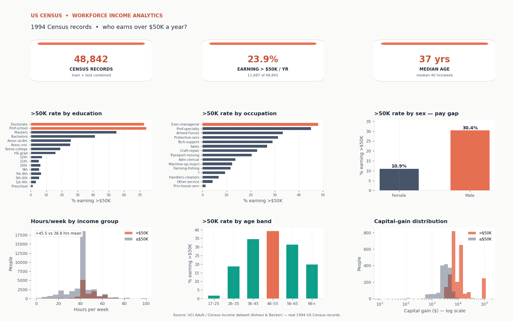

# US Census Workforce Income Analytics

An end-to-end data analysis project on **real** workforce data: the UCI "Adult"
(Census Income) dataset — 48,842 records from the 1994 US Census — plus a polished
multi-panel income dashboard built with pandas, matplotlib, and seaborn.



> **A note on the folder name:** this directory is still called
> `hr-attrition-dashboard` for legacy reasons, but this project is **not** about HR
> attrition and does **not** use the famous IBM HR Attrition sample (which is itself
> fictional/synthetic data). It was rebuilt on a **real** workforce dataset instead:
> US Census income records. The title, data, and every number below are the real thing.

## Overview

The dashboard answers one question: **who earns more than $50K a year, and what
drives it?**

- **KPI row** — 48,842 census records, 23.9% earning >$50K, median 40 hours/week,
  median age 37.
- **>50K rate by education** — a steep schooling gradient: 74.0% for Prof-school and
  72.6% for Doctorate holders vs 15.9% for HS graduates and 1.2% for Preschool.
- **>50K rate by occupation** — Exec-managerial (47.8%) and Prof-specialty (45.1%)
  lead; Priv-house-serv (1.2%) and Other-service (4.1%) trail.
- **>50K rate by sex** — a stark gender pay gap: 30.4% of men vs 10.9% of women
  (men at 2.8x the rate).
- **Hours/week distribution** — both groups centre on 40 h, but >50K earners average
  45.5 h/week vs 38.8 h for the rest.
- **>50K rate by age band** — earnings peak at 45–54 (39.4%); only 1.1% of 17–24
  year-olds clear $50K.
- **Capital-gain distribution (log scale)** — 21.3% of >50K earners report capital
  gains (median $7,688) vs 4.2% of the rest (median $3,325).

## Key insights (computed from the real data)

- **Education is the strongest income driver** — Prof-school graduates earn >$50K at
  74.0% and Doctorates at 72.6%, roughly 4.6x the 15.9% rate of HS graduates.
- **A stark gender pay gap** — 30.4% of men (n=32,650) vs 10.9% of women (n=16,192)
  earn >$50K: men clear the bar at 2.8 times the rate of women.
- **Occupation matters** — Exec-managerial (47.8%) and Prof-specialty (45.1%) top the
  chart, while Priv-house-serv (1.2%) and Other-service (4.1%) sit at the bottom.
- **Peak earning years are 45–54** (39.4% >$50K); the rate climbs from 1.1% at 17–24
  to 16.8% at 25–34 and 33.3% at 35–44, then falls to 20.5% at 65+.
- **Higher earners work longer** — mean 45.5 h/week for >$50K vs 38.8 h for the rest
  (median 40 h for both).
- **Capital gains separate the groups** — 21.3% of >$50K earners report gains vs
  4.2% of the rest, with median gains of $7,688 vs $3,325.

## Dataset

- **Name:** Adult (Census Income) — real 1994 US Census records.
- **Source:** UCI Machine Learning Repository — <https://archive.ics.uci.edu/dataset/2/adult>
- **Direct download used by `download_data.py`:** <https://archive.ics.uci.edu/static/public/2/adult.zip>
- **Donors:** Ronny Kohavi and Barry Becker.
- **Size:** 48,842 rows × 15 columns (train 32,561 + test 16,281 combined, no sampling).
- **Cleaning (applied identically by `download_data.py`):**
  - Files are comma-separated without headers — column names assigned in the documented UCI order.
  - All text fields stripped of surrounding whitespace.
  - `?` is the dataset's native missing-value marker (workclass: 2,799 · occupation: 2,809 ·
    native-country: 857) and is kept as-is in the CSV.
  - The test file's one-line header (`|1x3 Cross validator`) is skipped and the trailing
    periods on its income labels (`>50K.` / `<=50K.`) are stripped so the `income` column
    is consistent across train and test.

## Tech stack

- Python 3.12
- pandas 2.1.4 — data wrangling
- matplotlib 3.6.3 (Agg backend) — dashboard rendering
- seaborn 0.13.2 — plot styling (histplot support)
- numpy 1.26.4 — numeric binning/aggregation

## How to run

```bash
pip install -r requirements.txt

# 1. Download the real UCI Adult dataset, clean it, save data/adult_census.csv
python3 download_data.py

# 2. Render the dashboard to dashboard.png (1600x1000 px)
python3 dashboard.py
```

> Rebuilding this in Power BI? See **[powerbi-guide.md](powerbi-guide.md)** — a
> step-by-step Arabic guide. Fastest path: paste
> [powerbi-page1-overview.py](powerbi-page1-overview.py) (KPIs + education/occupation)
> and [powerbi-page2-details.py](powerbi-page2-details.py) (pay gap, hours, age,
> capital gain) into two Python visuals, with `dashboard.png` as the visual reference.

## Project structure

```
hr-attrition-dashboard/          # legacy folder name; project is the census income dashboard below
├── download_data.py            # downloads + cleans the real UCI Adult dataset
├── dashboard.py                # multi-panel dashboard renderer (matplotlib, Agg)
├── requirements.txt            # pinned dependencies
├── README.md                   # this file
├── powerbi-guide.md            # Arabic step-by-step Power BI rebuild guide
├── powerbi-page1-overview.py   # paste-ready Power BI Python visual — Page 1
├── powerbi-page2-details.py    # paste-ready Power BI Python visual — Page 2
├── dashboard.png               # rendered dashboard (1600x1000)
└── data/
    └── adult_census.csv        # cleaned real census data (48,842 rows, ~5 MB)
```

## Data dictionary (`data/adult_census.csv`)

| Column | Description |
|---|---|
| age | Age in years (17–90) |
| workclass | Type of employer (Private, Self-emp-*, Federal-gov, …; `?` = missing) |
| fnlwgt | Census sampling weight |
| education | Highest education level (Preschool … Doctorate) |
| education-num | Education level as a number (1–16, ordered) |
| marital-status | Marital status |
| occupation | Occupation (14 categories; `?` = missing) |
| relationship | Family relationship (Husband, Wife, Own-child, …) |
| race | Race |
| sex | Male / Female |
| capital-gain | Capital gains in USD (0 for most records) |
| capital-loss | Capital losses in USD (0 for most records) |
| hours-per-week | Usual hours worked per week |
| native-country | Country of origin (`?` = missing) |
| income | `>50K` if annual income exceeds $50,000, else `<=50K` |
